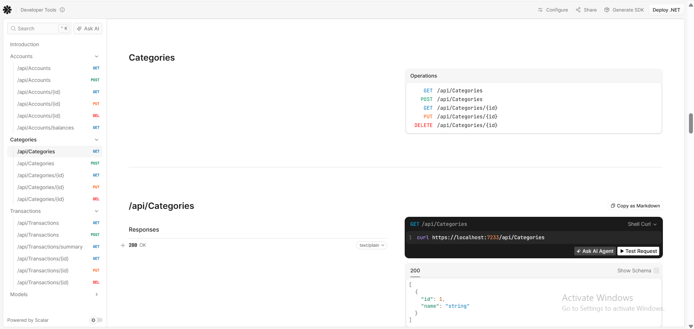

# Personal Finance API

A backend REST API for tracking savings accounts, categories and transactions,
with balance and monthly spending summaries.

## Tech stack

- C# / ASP.NET Core Web API (.NET 10)
- Entity Framework Core 10 with PostgreSQL (Npgsql)
- Docker Compose for the database
- Scalar for interactive API docs

## Features

- CRUD for accounts, categories and transactions
- Filter transactions by account, category, type and date range
- Balance per account (opening balance + income - expenses)
- Monthly spending per category
- Input validation and clear error responses
- Seeded default categories

## Getting started

1. Start the database:

       docker compose up -d

2. From the project folder, set the connection string:

       dotnet user-secrets init
       dotnet user-secrets set "ConnectionStrings:FinanceDb" "Host=localhost;Port=5433;Database=personalfinance;Username=postgres;Password=postgres"

3. Apply migrations:

       dotnet ef database update

4. Run the API:

       dotnet run

5. Open Scalar at `https://localhost:<port>/scalar/v1`.

The credentials above are for local development only.

## Endpoints

| Method | Route | Description |
|---|---|---|
| GET | /api/accounts | List accounts |
| GET | /api/accounts/{id} | Get one account |
| GET | /api/accounts/balances | Balance of every account |
| POST | /api/accounts | Create an account |
| PUT | /api/accounts/{id} | Update an account |
| DELETE | /api/accounts/{id} | Delete an account (blocked if it has transactions) |
| GET | /api/categories | List categories |
| POST / PUT / DELETE | /api/categories | Manage categories |
| GET | /api/transactions | List, with optional filters |
| GET | /api/transactions/summary?year=&month= | Spending per category for a month |
| POST / PUT / DELETE | /api/transactions | Manage transactions |

## Screenshot

